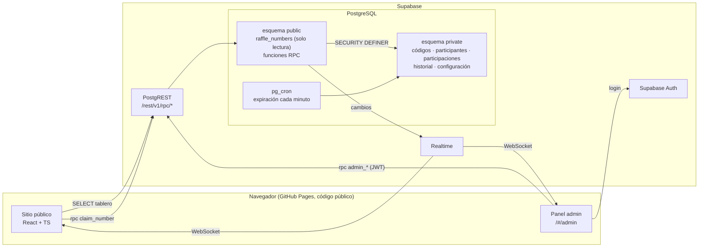
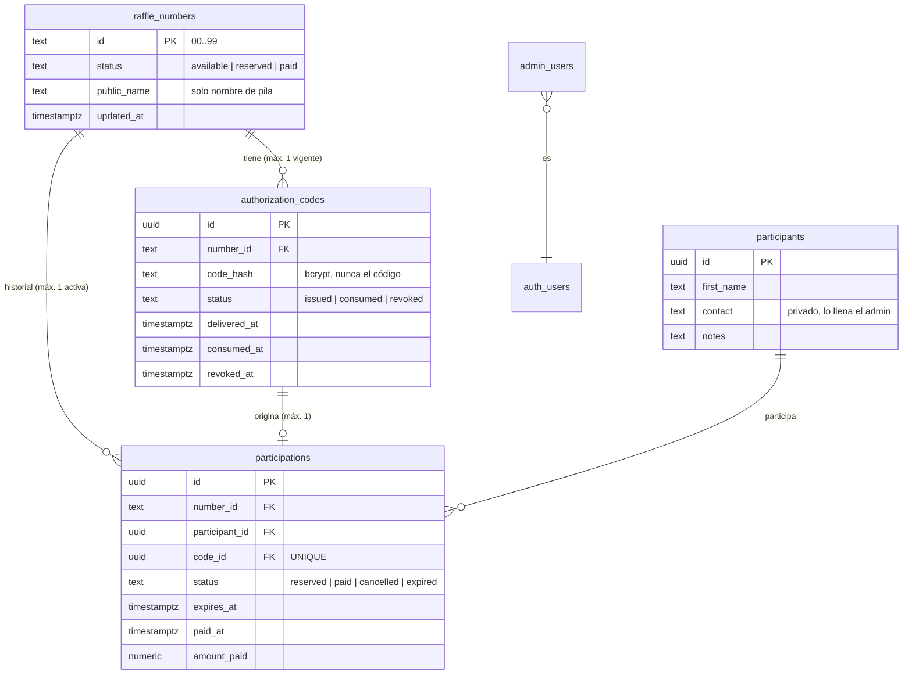
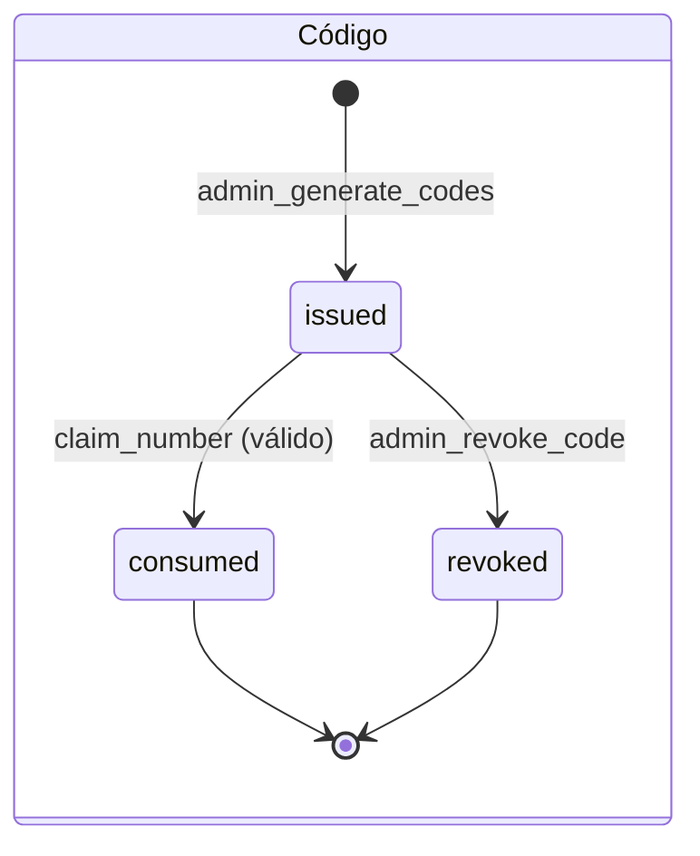
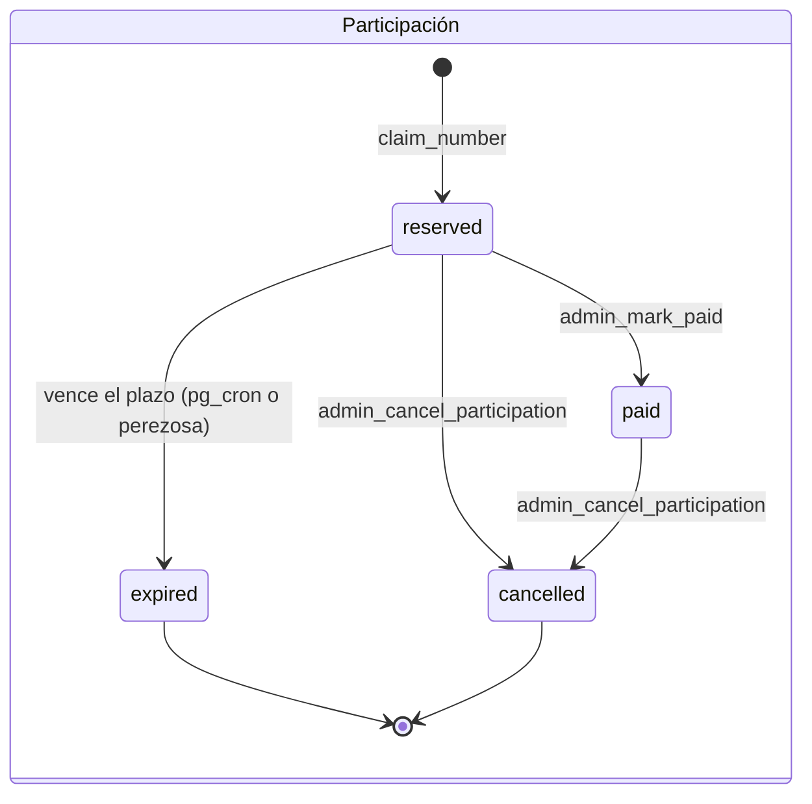
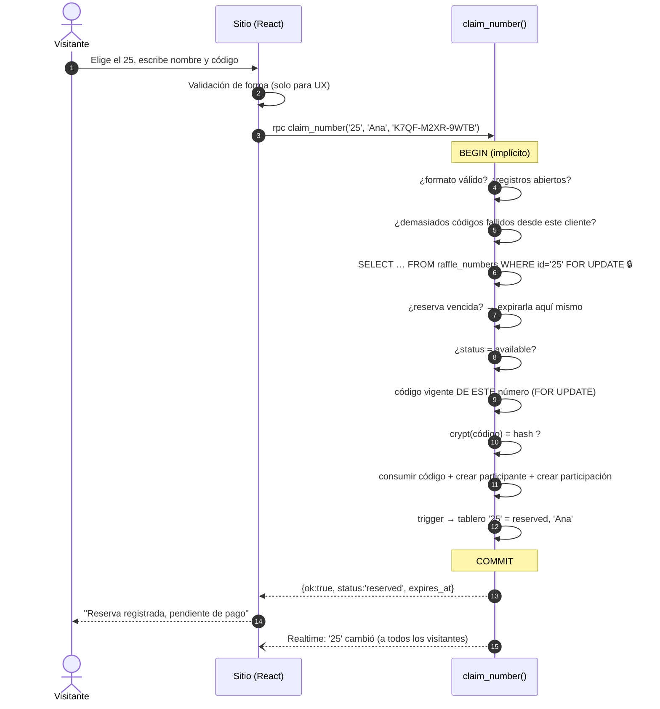

# Arquitectura — Rifa solidaria rumbo a Cracovia

> Etapa 1 del desarrollo incremental: arquitectura, modelo de datos, flujo de registro y
> la capa de seguridad en la base de datos (migraciones probadas). La interfaz pública y el
> panel se construyen en las etapas siguientes sobre esta base.

---

## 1. Idea central en una frase

**El navegador nunca decide nada importante.** El sitio en GitHub Pages es solo una
"ventanilla": muestra el tablero y envía solicitudes. Quien valida códigos, asigna números,
confirma pagos y escribe el historial es PostgreSQL, dentro de funciones que se ejecutan en
una sola transacción.

### ¿Por qué así?

Un sitio en GitHub Pages es 100 % estático: todo su código JavaScript lo puede leer y
modificar cualquier visitante desde las herramientas del navegador. Por lo tanto:

- Cualquier validación hecha **solo** en el navegador se puede saltar.
- Cualquier secreto puesto en el código del frontend es público.

La consecuencia es que la seguridad tiene que vivir del otro lado de la red. Supabase nos da
dos opciones para eso: *Edge Functions* (servidor en Deno) o **funciones de PostgreSQL**
llamadas por RPC. Elegimos las segundas porque:

| Criterio | Funciones SQL (elegido) | Edge Functions |
|---|---|---|
| Atomicidad | Nativa: la función *es* una transacción | Hay que abrir una transacción desde el servidor o llamar igualmente a una función SQL |
| Concurrencia | Bloqueos de fila de PostgreSQL | Mismos bloqueos, con un salto de red extra |
| Piezas que desplegar | Solo migraciones | Migraciones + código Deno + secretos |
| Pruebas | Se prueban contra PostgreSQL real (ver §10) | Requiere emular el runtime |

Las Edge Functions serán útiles más adelante si se necesitara algo que la base de datos no
puede hacer (por ejemplo, enviar un correo de confirmación).

---

## 2. Vista general



**Lectura del diagrama:** el público solo toca dos cosas: la tabla `raffle_numbers`
(lectura) y la función `claim_number`. El esquema `private` es invisible desde fuera; solo
se llega a él a través de funciones que validan cada operación.

---

## 3. Modelo de datos

### 3.1 Dos esquemas, dos niveles de confianza

| Esquema | Quién lo ve | Contenido |
|---|---|---|
| `public` | Todo el mundo (lectura) | `raffle_numbers`: id, estado, nombre de pila, fecha de cambio. Nada más. |
| `private` | Nadie directamente | Todo lo demás. Solo accesible mediante funciones. |

Separarlo en esquemas (y no solo con RLS) es deliberado: Supabase concede por defecto
permisos sobre todo lo que se crea en `public`, y PostgREST expone automáticamente ese
esquema. Un esquema aparte que **no** está expuesto elimina una clase entera de errores.

### 3.2 Diagrama entidad–relación



Tablas de soporte: `settings` (fila única: registros abiertos, duración de la reserva,
precio, moneda), `admin_audit_log` (solo anexar) y `claim_attempts` (límite de intentos).

### 3.3 ¿Por qué `raffle_numbers` repite el estado si ya está en `participations`?

La **fuente de verdad** son las participaciones (con su historial completo). Pero el público
no puede leerlas, y Supabase Realtime necesita una tabla legible para transmitir cambios.
Por eso `raffle_numbers` es una *proyección pública* que mantiene **un trigger**
(`private.sync_number`), no las funciones a mano. Ventaja: es imposible que una función
olvide actualizar el tablero; cualquier cambio en una participación lo sincroniza.

### 3.4 Restricciones que garantizan integridad aunque haya un error en el código

| Regla de negocio | Cómo la impone la base de datos |
|---|---|
| Exactamente 100 números `00`–`99` como texto | `id text` + `CHECK (id ~ '^[0-9]{2}$')` + PK + trigger que impide borrar |
| Un número no puede asignarse dos veces | Índice único parcial `participations(number_id) WHERE status IN ('reserved','paid')` |
| Un código no puede originar dos participaciones | `participations.code_id UNIQUE` |
| Máximo un código vigente por número | Índice único parcial `authorization_codes(number_id) WHERE status = 'issued'` |
| Un código consumido o revocado no revive | Trigger `trg_codes_guard`: estados terminales inmutables |
| El historial no se reescribe | Triggers: participaciones terminadas inmutables, sin `DELETE`; log sin `UPDATE/DELETE/TRUNCATE` |
| Un pago confirmado no se edita en silencio | Trigger: `paid_at` y `amount_paid` inmutables una vez en `paid` |
| "Pagado" implica fecha y monto | `CHECK (status <> 'paid' OR (paid_at IS NOT NULL AND amount_paid IS NOT NULL))` |

Estas reglas se cumplen **incluso para un superusuario** que edite tablas a mano (lo
verifican las pruebas).

---

## 4. Máquinas de estado





Estado del número en el tablero (derivado):

| Participación activa | Tablero | Se muestra al público |
|---|---|---|
| ninguna | `available` | Disponible |
| `reserved` | `reserved` | Reservado + nombre de pila |
| `paid` | `paid` | Ocupado + nombre de pila |

Cuando una participación termina (`expired` o `cancelled`) el número vuelve a
`available`, **pero el código que se usó sigue `consumed`**. Para reasignar el número hay
que generar un código nuevo.

---

## 5. Flujo de registro



### 5.1 Respuestas posibles

`claim_number` **devuelve** un JSON en vez de lanzar errores. Dos motivos: (1) si lanzara
una excepción, PostgreSQL desharía también el registro del intento fallido y el límite de
intentos no funcionaría; (2) así controlamos exactamente qué se le dice al público.

| `error` | Significado | Mensaje sugerido en la UI |
|---|---|---|
| — (`ok: true`) | Reserva creada | "¡Listo! El 25 está reservado a tu nombre. Tu lugar queda confirmado cuando se verifique tu pago." |
| `invalid_input` | Número, nombre o código mal escritos | "Revisa los datos." |
| `number_unavailable` | Alguien lo tomó antes | "Este número acaba de ser apartado. Elige otro." |
| `invalid_code` | Código inexistente, de otro número, revocado o usado | "El código no es válido para este número." |
| `rate_limited` | 8 códigos erróneos en 15 min | "Demasiados intentos. Espera unos minutos." |
| `raffle_closed` | El admin cerró el registro | "El registro está cerrado." |

`invalid_code` es deliberadamente **uno solo** para cuatro causas distintas: distinguirlas le
diría a un atacante si un código existe para otro número o si ya se usó.

---

## 6. Concurrencia: por qué no puede haber doble asignación

**Intuición.** Imagina la taquilla de un cine con un solo boleto físico por asiento. Si dos
personas piden el asiento 25 a la vez, la taquillera toma el boleto con la mano: la segunda
persona espera, y cuando la primera se va con él, a la segunda se le dice "ya no está".

**Técnicamente.** `SELECT … FOR UPDATE` sobre la fila `'25'` de `raffle_numbers` es ese
"tomar el boleto con la mano". Una segunda transacción que pida la misma fila **se bloquea**
hasta que la primera haga `COMMIT`; entonces relee la fila, ve `reserved` y responde
`number_unavailable`.

Hay tres capas, de modo que fallar una no basta para romper la regla:

1. **Bloqueo de fila** del número (evita la carrera).
2. **Bloqueo del código** + `UPDATE … WHERE status='issued'` comprobando que afectó 1 fila.
3. **Índices únicos** (`one_active_per_number`, `code_id UNIQUE`): si todo lo anterior
   fallara, la base rechaza la escritura y el sub-bloque se revierte entero, sin dejar el
   código consumido a medias.

**Orden de bloqueo uniforme.** Todas las funciones bloquean primero el número y después la
participación o el código. Usar siempre el mismo orden es lo que evita interbloqueos
(*deadlocks*). El job de expiración usa `SKIP LOCKED`: si un número está ocupado por otra
operación, lo deja para el siguiente minuto en lugar de esperar.

Las pruebas comprueban ambas cosas: un caso **determinista** (A deja la transacción abierta,
se verifica que B queda bloqueado, A confirma, B recibe `number_unavailable`) y un caso de
**carrera real** con 20 hilos simultáneos (exactamente uno gana).

---

## 7. Códigos de autorización

| Decisión | Valor | Por qué |
|---|---|---|
| Formato | `XXXX-XXXX-XXXX` | Fácil de dictar o copiar en WhatsApp |
| Alfabeto | Crockford Base32 (`0-9A-Z` sin `I L O U`) | Sin caracteres confundibles. Al validar se aceptan `O→0`, `I/L→1`, minúsculas y sin guiones |
| Entropía | 12 × 5 bits = **60 bits** | ≈ 1.15 × 10¹⁸ combinaciones *por número* |
| Generación | `gen_random_bytes` (CSPRNG) dentro de PostgreSQL | No depende del navegador del admin; tomar 5 bits de cada byte no introduce sesgo |
| Almacenamiento | **Solo** hash bcrypt (coste 8) | Si se filtrara la base, los códigos no se pueden leer |
| Visibilidad | Texto plano devuelto **una vez** al generarlo | El panel lo ofrece como descarga CSV; nunca vuelve a estar disponible |
| Vínculo | El código se busca **por número** | El código del 25 no aparece al validar el 26: imposible por construcción |

**¿Y si pierdo un código antes de entregarlo?** Se revoca y se genera otro para ese número.
Es la consecuencia aceptada de no guardar el texto plano.

**¿Por qué bcrypt si el código ya es aleatorio?** Contra adivinanzas *en línea* basta con la
entropía y el límite de intentos. bcrypt protege el caso *fuera de línea* (alguien obtiene
una copia de la tabla). Como solo se compara contra un hash por número, el coste extra por
registro es de milisegundos.

**Tiempo de respuesta constante.** Si un número no tiene código vigente, igualmente se
calcula bcrypt contra un hash señuelo; así el tiempo de respuesta no revela qué números
tienen código emitido.

---

## 8. Capas de seguridad

| Capa | Mecanismo |
|---|---|
| Red / esquema | `private` no está expuesto por PostgREST; `anon` y `authenticated` no tienen `USAGE` |
| Permisos | `REVOKE ALL` explícito (Supabase concede por defecto) y `GRANT` mínimo función por función |
| RLS | `raffle_numbers`: solo `SELECT`. Tablas privadas: RLS activo **sin políticas** (deniega todo) |
| Funciones | `SECURITY DEFINER` + `search_path = ''` + nombres calificados (evita secuestro de `search_path`) |
| Admin | Cada `admin_*` llama a `private.assert_admin()`: `auth.uid()` debe estar en `private.admin_users` |
| Integridad | `CHECK`, índices únicos y triggers de transición (§3.4) |
| Abuso | Límite de 8 códigos erróneos / 15 min por cliente (hash de IP, nunca la IP en claro) |
| Auditoría | Toda operación relevante deja fila en `admin_audit_log`, sin códigos ni hashes |

**Trampa común de Supabase.** En un proyecto nuevo, toda función creada en `public` se puede
invocar como `anon`. Si una migración futura agrega una función y olvida el `REVOKE`,
quedaría pública. La prueba `test_function_grants_are_minimal` falla en ese caso.

**Claves.** El frontend solo usa la clave **pública** del proyecto (publishable / anon). La
clave de servicio (`service_role` / secret) nunca va al repositorio ni al navegador; para
esta arquitectura no se necesita en absoluto.

---

## 9. Reservas y su duración

**Decisión confirmada:** una reserva dura **hasta que el administrador confirma el pago o la
cancela**. No hay vencimiento automático, porque los participantes son familiares y conocidos
y el seguimiento es personal.

- `settings.reservation_ttl` vale `null` por defecto (sin vencimiento).
- El mecanismo de expiración se conserva **desactivado**, por si en el futuro se quisiera un
  plazo: basta con `admin_update_settings({"reservation_hours": 72})`. En ese caso,
  pg_cron ejecuta `private.expire_reservations()` cada minuto y `claim_number` también
  expira de forma perezosa el número que se intenta registrar. Liberar por vencimiento
  nunca reactiva el código consumido.
- Mientras el plazo sea `null`, el job de pg_cron no encuentra nada que expirar y su costo
  es despreciable.

---

## 10. API (RPC)

### Pública (`anon`)

| Función | Devuelve |
|---|---|
| `SELECT * FROM raffle_numbers` | 100 filas: `id, status, public_name, updated_at` |
| `get_public_config()` | `registrations_open, price_per_number, currency, reservation_hours` |
| `claim_number(number, first_name, code)` | ver §5.1 |

### Administración (`authenticated` + estar en `admin_users`)

| Función | Efecto |
|---|---|
| `is_admin()` | `true/false` (para mostrar u ocultar el panel) |
| `admin_list_numbers()` | 100 filas con participante, contacto, fechas, pago y código vigente |
| `admin_get_stats()` | totales, recaudación **confirmada** (solo `paid`), códigos pendientes |
| `admin_generate_codes(numbers[] \| null)` | Genera y devuelve `(number_id, code, code_id)` **una vez**. `null` = todos los disponibles sin código. Atómico |
| `admin_list_codes(status?)` | Metadatos de códigos (sin hash ni texto) |
| `admin_mark_code_delivered(code_id, note?)` | Control de entrega |
| `admin_revoke_code(code_id, reason?)` | Solo códigos `issued` |
| `admin_mark_paid(number, amount?, note?)` | `reserved → paid`. Monto por defecto = precio configurado |
| `admin_cancel_participation(number, reason)` | `reserved/paid → cancelled`, libera el número. Motivo obligatorio |
| `admin_update_participant(number, first_name, contact?, notes?)` | Corrige datos; el tablero se actualiza solo |
| `admin_update_settings(patch jsonb)` | Registros abiertos, horas de reserva, precio, moneda |
| `admin_list_audit(limit)` | Últimas operaciones con su autor |

Errores de administración: `42501` (no autorizado), `22023` (operación no válida, con
mensaje como `not_eligible: 05`), `P0002` (no existe).

---

## 11. Frontend

```
index.html                   página pública
admin/index.html             panel (página aparte: los visitantes no descargan su código)
src/
  content.ts                 TODOS los textos editables (premio, propósito, reglas, sorteo)
  lib/
    supabase.ts              cliente único; null si faltan las variables → "en preparación"
    api.ts                   único módulo que llama a Supabase (tablero, config, claim)
    board.ts                 lógica pura: validación de las 100 filas, Realtime, búsqueda
    types.ts                 NumberId = `${Digit}${Digit}`, estados y respuestas
  features/
    board/                   BoardSection, Seat, useBoard (Realtime + respaldo)
    claim/                   ClaimDialog (<dialog> nativo)
  sections/                  Header, Hero (boleto), Prize, Purpose (ruta MEX→KRK), Rules, Footer
  styles/global.css          tokens de diseño (colores, tipografía, espaciado)
```

Decisiones:

- **El panel será una segunda página real (`/admin/`), no una ruta con `HashRouter`.**
  Así funcionan las anclas `#premio` y `#numeros` de la página pública, recargar `/admin/`
  no da 404 en GitHub Pages (el archivo existe) y los visitantes no descargan el código del
  panel.
- **El tablero es estado del servidor.** No existe un arreglo local de "números ocupados".
  `toBoardMap` exige exactamente las 100 filas; si falta una, muestra error en lugar de
  suponer "disponible". Sin Supabase configurado, las butacas aparecen sin estado y el
  tablero dice "en preparación".
- **Actualización:** Realtime para cambios inmediatos; recarga completa al conectar el canal,
  al volver a la pestaña y al recuperar la red; recarga cada 30 s si el canal falla. Los
  eventos atrasados se descartan comparando `updated_at`.
- **Sin confirmaciones optimistas.** Si la red falla tras enviar un registro, la interfaz
  dice "no pudimos confirmar" y pide revisar el tablero antes de reintentar: nunca lo da
  por hecho ni por fallido.
- **Accesibilidad:** el tablero es un `role="grid"` con un solo punto de tabulación y
  navegación con flechas (100 tabulaciones serían inutilizables). Cada estado se distingue
  también sin color (contorno, rayas, relleno). Los contrastes cumplen WCAG AA, incluido el
  3:1 de los elementos no textuales. Se respeta `prefers-reduced-motion`.
- **Panel:** login con Supabase Auth; cada acción llama a una función `admin_*` que vuelve a
  verificar al administrador en el servidor. Los códigos generados se muestran una sola vez
  (con "Copiar mensaje para WhatsApp" y descarga CSV) y nunca viajan en una URL.
- **Vista previa al compartir:** metadatos Open Graph con URL absoluta, que el workflow
  calcula (`https://<usuario>.github.io/<repo>/`) e inyecta un plugin de Vite.
- **Fuentes autoalojadas** (`@fontsource`): sin peticiones a terceros y funcionan aunque
  Google Fonts esté bloqueado.
- **Ruta base:** `BASE_PATH=/<repositorio>/` en el workflow de despliegue. Verificado
  sirviendo el sitio bajo un subdirectorio sin recursos rotos.

## 12. Pruebas

```bash
# PostgreSQL 16 local (o el de Docker): cualquier superusuario sirve
pip install -r tests/db/requirements.txt
cd tests/db
DATABASE_URL=postgresql://postgres@localhost:5432/postgres pytest -q
```

`tests/db/supabase_stub.sql` reproduce lo mínimo de Supabase (roles, `auth.uid()`,
`auth.jwt()`, privilegios por defecto, publicación de Realtime). Cada prueba corre en una copia
nueva de la base y termina verificando las **invariantes globales**: tablero sincronizado
con las participaciones, todo código consumido con exactamente una participación y viceversa,
y ninguna participación usando el código de otro número.

Las pruebas se validaron también con *mutaciones* (romper a propósito una protección y
comprobar que alguna prueba falla): quitar un `REVOKE`, desactivar el trigger de códigos,
dejar de filtrar el código por número, y quitar el bloqueo + índice único. Las cuatro
mutaciones fueron detectadas.

El workflow `.github/workflows/db-tests.yml` ejecuta la misma suite en cada cambio.

Frontend (`npm test`, Vitest): validación del tablero, eventos de Realtime fuera de orden,
búsqueda sin acentos, normalización del código igual a la del servidor y comportamiento sin
Supabase configurado.

---

## 13. Puesta en marcha de la base

La guía paso a paso está en [INSTALAR_SUPABASE.md](INSTALAR_SUPABASE.md). En resumen: se pega
`supabase/instalacion_completa.sql` (las 6 migraciones unidas; se regenera con
`npm run sql:bundle`) en el SQL Editor, se cierra el registro público de usuarios, se crea el
usuario administrador y se registra en `private.admin_users`.

Este procedimiento se probó en una base vacía con el mismo stub de Supabase que usan las
pruebas: instalación en una sola transacción, registro del admin, generación de un código
y reserva del número como visitante anónimo.

---

## 14. Decisiones de negocio confirmadas

| Tema | Decisión |
|---|---|
| Premios | **Un solo paquete:** quien gana se lleva la televisión de 75" y el equipo de sonido |
| Nombre público | Los números reservados **y** los pagados muestran el nombre de pila, para que cada quien se ubique fácilmente |
| Duración de la reserva | Indefinida: hasta que el admin confirma el pago o cancela |
| Cancelar | Libera el número; para reasignarlo se genera un código nuevo |
| Pago confirmado | Irreversible; si hubo un error se cancela con motivo y queda en el historial |
| Precio | $700 MXN por número (migración 6). El sitio lo lee de la base, no está escrito en el código |
| Sorteo | Sábado 12 de diciembre de 2026, 20:00 h. Sorteo Especial No. 319 de la Lotería Nacional; gana el número igual a las dos últimas cifras del premio mayor |

---

## 15. Limitaciones conocidas y mejoras posibles

- **Límite de intentos por IP:** depende de las cabeceras que entregue el proxy de
  Supabase. Si no llegan, todos comparten el cubo `unknown` con un límite 10 veces mayor.
  No es la defensa principal: con 60 bits por número, adivinar es inviable de todos modos.
- **Hash de IP sin sal:** el espacio IPv4 es pequeño, así que no es anonimización fuerte;
  solo evita guardar la IP en claro. Los intentos se purgan a los 7 días.
- **Revertir un pago** (de `paid` a `reserved`) no está permitido a propósito; si hubo un
  error, se cancela con motivo y se reasigna con un código nuevo, quedando todo en el
  historial.
- **MFA para el admin:** Supabase Auth admite TOTP; se puede exigir `aal2` en
  `assert_admin()` como mejora.
- **Un participante = un registro.** Si una misma persona compra varios números, se crean
  varios participantes; el admin puede unificar el contacto. Fusionarlos no es necesario
  para la rifa.
